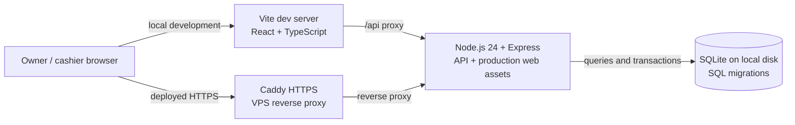

# Medtryx

**A full-stack point-of-sale and inventory app for a single pharmacy.** Medtryx brings cashier checkout and owner operations into one application, with a React interface, a TypeScript API, and a local SQLite database. The v1 release is designed for one store on one server, with a local development setup and a manually dispatched VPS deployment workflow.

[](https://github.com/Jaaarl/Medtryx/actions/workflows/ci.yml)

## Project highlights

- **Point of sale:** cashiers build carts, review server-calculated totals, and record cash or staff-declared QR sales against the store's open shift.
- **Inventory:** owners manage products, CSV imports, supplier receipts, stock corrections, write-offs, lots, expiry dates, and component-based bundles.
- **Store operations:** owners review shifts, refunds, expenses, payment corrections, audit history, and date-range reports with formula-safe CSV exports.
- **Access and recovery:** owner and cashier roles, session and CSRF protections, encrypted benefit-ID fields when configured, and verified database backup and restore workflows.
- **Release discipline:** SQL schema changes are versioned as migrations; CI checks code and unit tests; VPS deployment is a separate, manual workflow for a reviewed `v1` revision.

## Architecture

The browser talks to the same Express application in both modes. During development, Vite serves the React app and proxies `/api` to Express. On a VPS, Caddy terminates HTTPS and forwards requests to Express, which serves the built frontend and API. Express applies SQL migrations and reads or writes the local SQLite database.



## Technology

- **Frontend:** React 19, TypeScript, Vite, Tailwind CSS
- **API:** Node.js 24, Express 5, TypeScript, Zod
- **Data:** SQLite via `better-sqlite3`, SQL migration files, transactional updates
- **Quality:** ESLint, TypeScript checks, Vitest unit tests, Playwright browser tests
- **Deployment:** systemd service behind Caddy; a GitHub Actions workflow packages a selected `v1` commit for manual VPS release

## Run locally

Use Node.js 24. From the repository root:

1. Install the locked dependencies: `npm ci`.
2. Copy `.env.example` to `.env`. Set `APP_ENV=development`, choose `MEDTRYX_CURRENCY=PHP` or `USD`, and set a unique `MEDTRYX_OWNER_EMAIL` and `MEDTRYX_OWNER_PASSWORD` for the one-time owner account. Set USD only before opening a new, empty database.
3. Run `npm run db:migrate` to initialize the selected local database.
4. Run `npm run db:create-owner` to create the first owner account. This command refuses to add an owner if the selected environment already has users. Remove `MEDTRYX_OWNER_PASSWORD` from `.env` after bootstrap.
5. Start the app with `npm run dev`.

The web app is available at `http://127.0.0.1:5173`. The API listens at `http://127.0.0.1:3001`; Vite proxies `/api` requests to it. Development and test databases are isolated under `data/` by default. Live data must use a dedicated absolute path outside the repository. See [`.env.example`](.env.example) for configuration and the [deployment and recovery runbook](docs/DEPLOYMENT_AND_RECOVERY.md) for VPS setup.

## Checks and tests

Run the full local validation sequence with:

```sh
npm run format:check
npm run lint
npm run typecheck
npm test
npm run build
```

GitHub Actions runs lint, type checking, Vitest unit tests, and workspace builds on pushes to `v1` and pull requests targeting `v1`. The Playwright E2E suite can also be run locally with `npm run test:e2e` after installing Chromium with `npx playwright install chromium`.

## Product boundaries and documentation

Medtryx records operational sales and inventory; it does not process payments, verify QR payments, provide statutory invoicing, or certify tax/accounting compliance. The deployment workflow and configuration examples are included, but the actual host, domain, access policy, backup media, and recovery rehearsal remain deployment responsibilities.

- [V1 product and feature specification](docs/V1_SPECIFICATION.md)
- [VPS deployment and recovery runbook](docs/DEPLOYMENT_AND_RECOVERY.md)
- [V1 implementation plan and validation record](docs/V1_PLAN.md)
